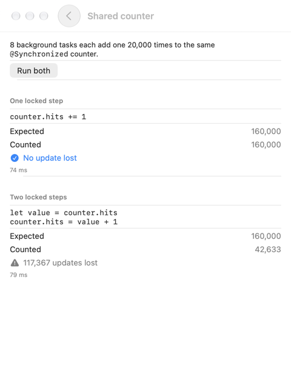
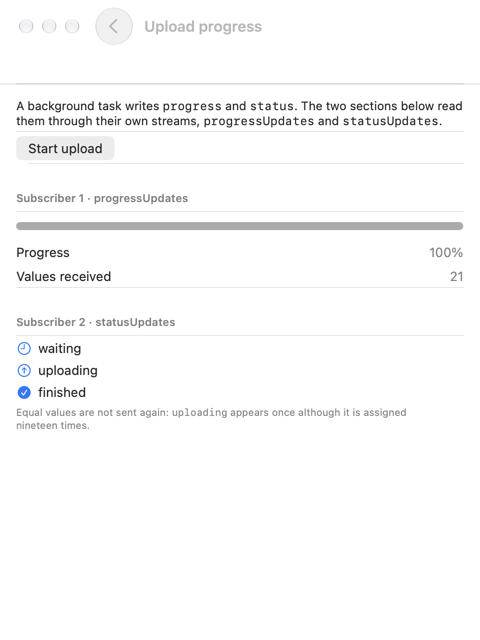

<!-- i18n-source: README.md@75c95a1af2692e0963799c764db0ab6495616095 status=reviewed -->
<!-- brand:start -->

<p align="center"><picture><source media="(prefers-color-scheme: dark)" srcset="https://raw.githubusercontent.com/muhittincamdali/SwiftCodeGen/main/.github/brand/banner-dark.svg"><source media="(prefers-color-scheme: light)" srcset="https://raw.githubusercontent.com/muhittincamdali/SwiftCodeGen/main/.github/brand/banner-light.svg"></picture></p>

<!-- lang-selector:start -->
<p align="center"><a href="README.md">English</a> · <a href="README.tr.md">Türkçe</a> · <a href="README.zh-CN.md">简体中文</a> · <a href="README.ja.md">日本語</a> · <a href="README.ko.md">한국어</a> · <a href="README.es.md">Español</a> · <a href="README.de.md">Deutsch</a> · <a href="README.fr.md">Français</a> · <a href="README.pt-BR.md">Português (Brasil)</a> · <a href="README.ru.md">Русский</a></p>
<!-- lang-selector:end -->

<p align="center">
<a href="https://github.com/muhittincamdali/SwiftCodeGen/actions/workflows/ci.yml"></a>
<a href="https://github.com/muhittincamdali/SwiftCodeGen/releases"><picture><source media="(prefers-color-scheme: dark)" srcset="https://raw.githubusercontent.com/muhittincamdali/SwiftCodeGen/main/.github/brand/badge-version-dark.svg"><source media="(prefers-color-scheme: light)" srcset="https://raw.githubusercontent.com/muhittincamdali/SwiftCodeGen/main/.github/brand/badge-version-light.svg"></picture></a>
<a href="https://github.com/muhittincamdali/SwiftCodeGen/blob/main/Package.swift"><picture><source media="(prefers-color-scheme: dark)" srcset="https://raw.githubusercontent.com/muhittincamdali/SwiftCodeGen/main/.github/brand/badge-platforms-dark.svg"><source media="(prefers-color-scheme: light)" srcset="https://raw.githubusercontent.com/muhittincamdali/SwiftCodeGen/main/.github/brand/badge-platforms-light.svg"></picture></a>
<a href="https://github.com/muhittincamdali/SwiftCodeGen/blob/main/Package.swift"><picture><source media="(prefers-color-scheme: dark)" srcset="https://raw.githubusercontent.com/muhittincamdali/SwiftCodeGen/main/.github/brand/badge-language-dark.svg"><source media="(prefers-color-scheme: light)" srcset="https://raw.githubusercontent.com/muhittincamdali/SwiftCodeGen/main/.github/brand/badge-language-light.svg"></picture></a>
<a href="https://github.com/muhittincamdali/SwiftCodeGen/blob/main/LICENSE"><picture><source media="(prefers-color-scheme: dark)" srcset="https://raw.githubusercontent.com/muhittincamdali/SwiftCodeGen/main/.github/brand/badge-license-dark.svg"><source media="(prefers-color-scheme: light)" srcset="https://raw.githubusercontent.com/muhittincamdali/SwiftCodeGen/main/.github/brand/badge-license-light.svg"></picture></a>
</p>

<p align="center">
<a href="#démarrage-rapide"><picture><source media="(prefers-color-scheme: dark)" srcset="https://raw.githubusercontent.com/muhittincamdali/SwiftCodeGen/main/.github/brand/button-start-fr-dark.svg"><source media="(prefers-color-scheme: light)" srcset="https://raw.githubusercontent.com/muhittincamdali/SwiftCodeGen/main/.github/brand/button-start-fr-light.svg"></picture></a>
<a href="https://muhittincamdali.github.io/SwiftCodeGen/documentation/swiftcodegen/"><picture><source media="(prefers-color-scheme: dark)" srcset="https://raw.githubusercontent.com/muhittincamdali/SwiftCodeGen/main/.github/brand/button-docs-fr-dark.svg"><source media="(prefers-color-scheme: light)" srcset="https://raw.githubusercontent.com/muhittincamdali/SwiftCodeGen/main/.github/brand/button-docs-fr-light.svg"></picture></a>
<a href="https://github.com/muhittincamdali/SwiftCodeGen/tree/main/Examples"><picture><source media="(prefers-color-scheme: dark)" srcset="https://raw.githubusercontent.com/muhittincamdali/SwiftCodeGen/main/.github/brand/button-examples-fr-dark.svg"><source media="(prefers-color-scheme: light)" srcset="https://raw.githubusercontent.com/muhittincamdali/SwiftCodeGen/main/.github/brand/button-examples-fr-light.svg"></picture></a>
</p>

> Ceci est une traduction du README anglais. En cas de différence, la version anglaise fait foi.

<!-- brand:end -->

SwiftCodeGen est un petit paquet de macros Swift 6 conçu pour un problème que la concurrence stricte (strict
concurrency) rend courant : une classe dont le code synchrone partage l’état entre plusieurs threads, comme un
cache, une session, un delegate de téléchargement ou un compteur. Swift 6 ne laisse une telle classe passer d’un
thread à l’autre que si elle est `Sendable`, et les solutions habituelles sont un verrou écrit à la main derrière
`@unchecked Sendable`, que le compilateur cesse de vérifier, ou un actor, qui transforme chaque appel en `await`.
Ajoutez plutôt `@Synchronized` : chaque `var` stockée est protégée par un seul verrou, `count += 1` ne peut pas
perdre de mise à jour, `withLock` regroupe plusieurs étapes, et la classe devient `Sendable` tout en conservant la
vérification du compilateur. `@Streamed` ajoute un `AsyncStream` des valeurs d’une propriété pour un nombre
quelconque d’abonnés.

## Points forts

- **`Sendable` vérifié, sans `@unchecked`** — la macro ajoute une véritable conformité à `Sendable` ; un `let` d’un
  type qui n’est pas `Sendable` reste donc une erreur de compilation.
- **Aucune mise à jour perdue** — les getters, les setters et les modifications sur place (`+=`, `append`,
  `dict[key] =`) s’exécutent sous le verrou ; dans les tests, 2 000 `+=` concurrents donnent exactement 2 000.
- **Plusieurs étapes en une** — `withLock { … }` garde le verrou pendant un bloc de code où la syntaxe de propriété
  habituelle s’applique, et laisse passer les erreurs typées (`throws(Failure)`).
- **Rien à réécrire** — les valeurs par défaut, `self.x = x` dans `init`, le `nil` implicite, `weak` et `unowned`
  continuent de fonctionner ; les propriétés `let`, calculées et `static` sont laissées telles quelles.
- **Flux de changements** — `@Streamed var progress: Double` ajoute `progressUpdates` : d’abord la valeur actuelle,
  puis chaque changement dans l’ordre, avec une valeur en tampon par abonné ; le flux se termine quand l’objet
  disparaît.
- **Des erreurs plutôt que des surprises** — les structs, les actors, les classes non `final`, `@MainActor`, `lazy`,
  les observateurs et les property wrappers sont refusés avec une raison et, quand la correction est évidente, avec
  un correctif.

## Démarrage rapide

**1. Ajouter le paquet**

Dans Xcode, choisissez **File › Add Package Dependencies…**, saisissez l’URL du dépôt et ajoutez la bibliothèque
**SwiftCodeGen** à votre target. Lors de la première compilation, choisissez **Trust & Enable** pour les macros.

```text
https://github.com/muhittincamdali/SwiftCodeGen.git
```

**2. Importer le module**

```swift
import SwiftCodeGen
```

**3. Ajoutez `@Synchronized` à une classe final**

Un cache que n’importe quel thread peut utiliser sans `await`
([ReadmeSamples.swift](Examples/SyncDemo/SyncDemo/ReadmeSamples.swift)) :

```swift
@Synchronized
final class ImageCache {
    var images: [URL: Data] = [:]
    var hits = 0
    var misses = 0

    func image(for url: URL) -> Data? {
        // Reading the cache and counting the hit or miss happen as one step.
        withLock {
            if let data = images[url] {
                hits += 1
                return data
            }
            misses += 1
            return nil
        }
    }

    func store(_ data: Data, for url: URL) {
        images[url] = data
    }
}
```

`ImageCache` est désormais `Sendable` : transmettez-la à un `Task.detached`, à un task group ou à un callback sur
n’importe quelle file, et appelez-la sans `await`.

## Installation

### Swift Package Manager

Ajoutez-le aux `dependencies` de votre `Package.swift` :

```swift
dependencies: [
    .package(url: "https://github.com/muhittincamdali/SwiftCodeGen.git", branch: "main")
],
targets: [
    .target(name: "YourApp", dependencies: [
        .product(name: "SwiftCodeGen", package: "SwiftCodeGen")
    ])
]
```

Le paquet dépend de [swift-syntax](https://github.com/swiftlang/swift-syntax) (602 à 604), que le compilateur
utilise pour développer les macros ; rien n’en est lié à votre app. Les compilations en ligne de commande avec
`xcodebuild` nécessitent `-skipMacroValidation`, ou une autorisation ponctuelle dans Xcode.

## Utilisation

Les exemples ci-dessous sont copiés depuis
[`ReadmeSamples.swift`](Examples/SyncDemo/SyncDemo/ReadmeSamples.swift), que l’app d’exemple compile avec
l’isolation par défaut MainActor (default isolation) et que la suite de tests exécute.

### Modifier plusieurs propriétés ensemble

Chaque accès à une propriété est une étape verrouillée. Les étapes qui vont ensemble se placent dans `withLock`,
afin qu’aucun autre thread ne voie `progress` et `status` en désaccord :

```swift
// `nonisolated`: with MainActor default isolation, the Equatable conformance would otherwise be
// isolated to the main actor, and the stream could not skip repeated values off the main actor.
nonisolated enum UploadStatus: Sendable, Equatable {
    case waiting
    case uploading
    case finished
}

/// Progress that a background upload writes and any number of views read.
@Synchronized
final class UploadTracker {
    let totalChunks: Int
    @Streamed var progress: Double = 0
    @Streamed var status: UploadStatus = .waiting
    private var sentChunks = 0

    init(totalChunks: Int) {
        precondition(totalChunks > 0, "An upload has at least one chunk")
        self.totalChunks = totalChunks
    }

    func chunkSent() {
        // The three properties change together; a reader never sees them disagree.
        withLock {
            sentChunks = min(sentChunks + 1, totalChunks)
            progress = Double(sentChunks) / Double(totalChunks)
            status = sentChunks < totalChunks ? .uploading : .finished
        }
    }
}
```

Le verrou est récursif : les accès aux propriétés à l’intérieur de `withLock` le reprennent donc sur le même thread.
Ne prenez pas les verrous de deux objets dans des ordres opposés sur deux threads ; cela provoque un interblocage
(deadlock), comme avec n’importe quelle paire de verrous.

### Suivre les changements avec `for await`

`@Streamed` a donné à `UploadTracker` les propriétés `progressUpdates` et `statusUpdates`. Chaque lecture renvoie un
nouveau flux qui commence par la valeur actuelle :

```swift
/// Waits until the upload has finished and returns the statuses it went through.
func waitForUpload(_ tracker: UploadTracker) async -> [UploadStatus] {
    var seen: [UploadStatus] = []
    for await status in tracker.statusUpdates {
        seen.append(status)
        if status == .finished { break }
    }
    return seen
}
```

Les valeurs sont envoyées pendant que le verrou est tenu, si bien que chaque abonné voit les changements dans
l’ordre où ils se sont produits. Pour un type `Equatable`, affecter à une propriété la valeur qu’elle a déjà
n’envoie rien ; dans une target d’app avec l’isolation par défaut MainActor, déclarez un tel type `nonisolated`,
comme `UploadStatus` ci-dessus, sinon sa conformité appartient à l’acteur principal et chaque affectation est
envoyée. Un abonné qui prend du retard ne garde que la valeur la plus récente. Les flux se terminent quand l’objet
est libéré, et un flux ne maintient pas son objet en vie.

### Initialiseurs et références weak

Les propriétés continuent de fonctionner dans les initialiseurs, les optionnels commencent à `nil` et `weak` reste
faible :

```swift
@Synchronized
final class Session {
    let id: UUID
    var token: String
    var expiresAt: Date?
    weak var observer: SessionObserver?

    init(token: String) {
        id = UUID()
        self.token = token
    }
}
```

### Ce que la macro écrit

Utilisez **Editor › Expand Macro** dans Xcode pour voir le code de n’importe quelle classe. Pour `var hits = 0`, il
s’agit de :

```swift
var hits {
    @storageRestrictions(initializes: _hits)
    init(initialValue) {
        _hits = initialValue
    }
    get {
        _lock.lock()
        defer {
            _lock.unlock()
        }
        return _hits
    }
    set {
        _lock.lock()
        defer {
            _lock.unlock()
        }
        _hits = newValue
    }
    _modify {
        _lock.lock()
        defer {
            _lock.unlock()
        }
        yield &_hits
    }
}

nonisolated(unsafe) private var _hits = 0
```

À cela s’ajoutent, une fois par classe, `private let _lock = SwiftCodeGen.SynchronizedLock()`, la méthode `withLock`
et `extension ImageCache: Sendable {}`. Le stockage est `nonisolated(unsafe)` parce que c’est le verrou, et non le
compilateur, qui le protège ; tous les autres membres de la classe restent vérifiés.

### Ce que la macro refuse

| Déclaration | Erreur et correctif proposé |
| --- | --- |
| `struct`, `enum` | Les types valeur sont `Sendable` quand leurs propriétés stockées le sont. |
| `actor` | Un actor protège déjà son état. |
| `class` sans `final` | Une sous-classe pourrait ajouter un état que le verrou ne protège pas. Correctif : ajoutez `final`. |
| `@MainActor` sur la classe ou sur une propriété | Le verrou remplace l’isolation de l’actor. Correctif : retirez-le. |
| `lazy var` | Correctif : retirez `lazy`. |
| `willSet` / `didSet` | Déplacez le code dans une méthode qui modifie la propriété. |
| Un property wrapper | Son stockage ne serait pas protégé. |
| `var a = 0, b = 1`, `var (a, b) = …` | Déclarez chaque propriété sur sa propre ligne. |
| `@Streamed` sur une propriété `let`, `static`, calculée, `weak` ou sans type | Chacune a son propre message. |

Pour exclure volontairement une propriété, marquez-la `nonisolated(unsafe)`.

## Démo

L’app d’exemple de [`Examples/SyncDemo`](Examples/SyncDemo) exécute les deux macros sur un iPhone ou sur un Mac. Les
captures d’écran ci-dessous proviennent de sa version Mac et ont été prises par
[`scripts/capture-mac-screens.sh`](scripts/capture-mac-screens.sh) ;
[`scripts/capture-example-screens.sh`](scripts/capture-example-screens.sh) prend les mêmes écrans dans un simulateur
d’iPhone.

| Compteur partagé | Progression de l’envoi |
| --- | --- |
| <picture><source media="(prefers-color-scheme: dark)" srcset="docs/images/demo-counter-dark.png"></picture> | <picture><source media="(prefers-color-scheme: dark)" srcset="docs/images/demo-upload-dark.png"></picture> |

## Documentation

- [Référence de SwiftCodeGen](https://muhittincamdali.github.io/SwiftCodeGen/documentation/swiftcodegen/)
- [Premiers pas](https://muhittincamdali.github.io/SwiftCodeGen/documentation/swiftcodegen/gettingstarted)
- [Diffuser les changements](https://muhittincamdali.github.io/SwiftCodeGen/documentation/swiftcodegen/streamingchanges)
- [Choisir un outil](https://muhittincamdali.github.io/SwiftCodeGen/documentation/swiftcodegen/choosingatool)

## Guides

- [Premiers pas](Sources/SwiftCodeGen/SwiftCodeGen.docc/GettingStarted.md) — ce que la macro change, `withLock`,
  l’isolation par défaut MainActor et les déclarations qu’elle refuse.
- [Diffuser les changements](Sources/SwiftCodeGen/SwiftCodeGen.docc/StreamingChanges.md) — ce que reçoit un abonné,
  quand un flux se termine, et `StreamBroadcast` utilisé seul.
- [Choisir un outil](Sources/SwiftCodeGen/SwiftCodeGen.docc/ChoosingATool.md) — quand un actor, `Mutex` ou un autre
  paquet est le meilleur choix.

## Quand utiliser autre chose

SwiftCodeGen n’est pas un générateur de code généraliste. Pour les tâches que font les outils bien connus,
utilisez-les :

| Vous voulez | Utilisez |
| --- | --- |
| Un état dont le travail est `async` (réseau, disque) | Un `actor` : ses méthodes peuvent se suspendre, alors qu’un verrou ne doit pas être tenu à travers un `await`. |
| Une ou deux valeurs protégées sur iOS 18+ | `Mutex` du module Synchronization. |
| Un état d’interface que SwiftUI observe | `@Observable` sur l’acteur principal. |
| Des mocks et des spies de protocoles | [Mockable](https://github.com/Kolos65/Mockable), [swift-spyable](https://github.com/Matejkob/swift-spyable) |
| Du code généré à partir de modèles pour de nombreux types | [Sourcery](https://github.com/krzysztofzablocki/Sourcery) |
| Des clients et des serveurs à partir d’un document OpenAPI | [swift-openapi-generator](https://github.com/apple/swift-openapi-generator) |
| Des noms typés pour les images, les couleurs et les chaînes | Les symboles d’assets et de String Catalog générés par Xcode ; [SwiftGen](https://github.com/SwiftGen/SwiftGen) pour les polices, les plists et les autres fichiers |
| Nouvelles tentatives, délais d’attente, requêtes single-flight | [SwiftConcurrency](https://github.com/muhittincamdali/SwiftConcurrency) |

## Prérequis

| Plateforme | Version minimale |
| --- | --- |
| iOS | 16 |
| macOS | 13 |
| tvOS | 16 |
| watchOS | 9 |
| visionOS | 1 |
| Chaîne d’outils | Swift 6.2 · Xcode 26+ |

## Architecture

| Target | Contenu |
| --- | --- |
| `SwiftCodeGen` | Les déclarations des macros, `SynchronizedLock` (un verrou récursif) et `StreamBroadcast` (un `AsyncStream` multi-abonnés) |
| `SwiftCodeGenMacros` | Le plugin du compilateur : `SynchronizedMacro` (rôles member, member-attribute et extension), `SynchronizedPropertyMacro` (accesseurs et stockage), `StreamedMacro` (vérifications), `PropertyAnalysis` et les diagnostics |
| `SwiftCodeGenTests` | Tests d’exécution sur macOS et sur le simulateur iOS : concurrence, flux, exemples du README |
| `SwiftCodeGenMainActorTests` | Les macros dans une target avec l’isolation par défaut MainActor, comme dans une nouvelle app |
| `SwiftCodeGenMacrosTests` | Les développements exacts et chaque diagnostic avec son fix-it (macOS) |

- **Un verrou par objet, pas par propriété.** Un seul verrou récursif permet à `withLock` de couvrir plusieurs
  propriétés et au code qu’il contient d’utiliser la syntaxe de propriété habituelle.
- **Des init accessors, pas des body macros.** Le stockage est initialisé via `@storageRestrictions(initializes:)`,
  si bien que les initialiseurs et les valeurs par défaut fonctionnent tels qu’ils sont écrits sur tous les
  compilateurs Swift 6.2.
- **`_modify` sous le verrou.** Les modifications sur place cèdent le stockage par `yield` pendant que le verrou est
  tenu ; c’est ce qui rend `+=` et `append` atomiques. Une propriété `weak` ou `unowned` ne reçoit que `get` et
  `set`.

## Feuille de route

- Une option pour nommer la propriété du flux (`@Streamed(as: "progressStream")`).
- Un `withLock` public pour les classes publiques, en option (`@Synchronized(.publicLock)`) ; il est aujourd’hui
  `internal`, afin que le code extérieur au module ne puisse pas tenir le verrou.
- Linux en CI : le paquet n’utilise que `NSRecursiveLock` et `NSLock` de Foundation, mais il n’est testé que sur les
  plateformes Apple.

## Contribuer

Les contributions sont les bienvenues. Lisez le [guide de contribution](https://github.com/muhittincamdali/SwiftCodeGen/blob/main/CONTRIBUTING.md) et le [code de conduite](https://github.com/muhittincamdali/SwiftCodeGen/blob/main/CODE_OF_CONDUCT.md) avant d’ouvrir une pull request. Signalez les problèmes de sécurité en privé, comme indiqué dans la [politique de sécurité](https://github.com/muhittincamdali/SwiftCodeGen/blob/main/SECURITY.md).

## Licence

Publié sous licence MIT. Voir [LICENSE](LICENSE).
